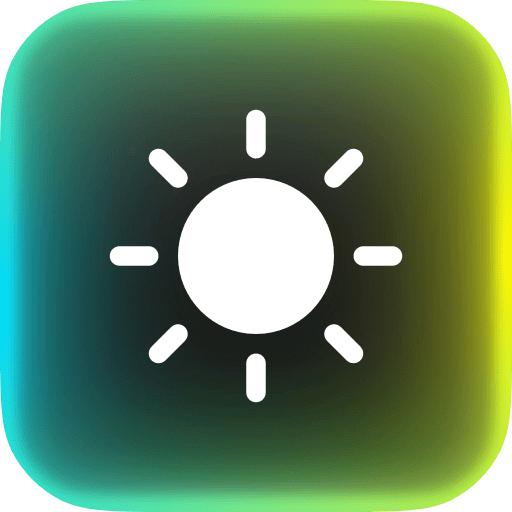
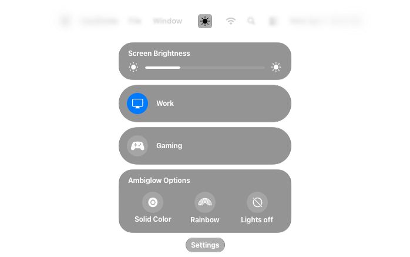
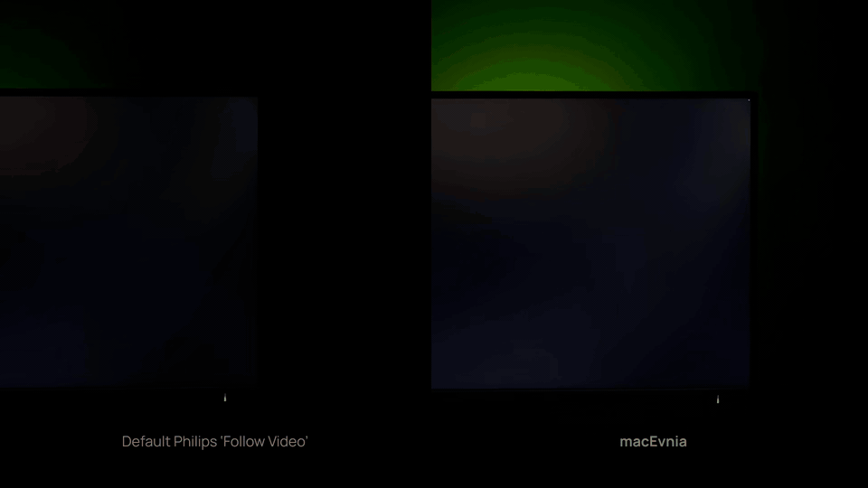

<p align="center">
  
</p>

# macEvnia

macEvnia is a native macOS menu bar app for Philips Evnia Ambiglow monitors that expose their backlight as a USB HID LampArray device.

It samples the screen, calculates LED colors, and sends them to the monitor in real time.

<p align="center">
  
</p>

## Demo

<p align="center">
  
</p>

The default Philips `Follow Video` mode can produce visible LED brightness jumps and uneven backlight transitions.

macEvnia gives the host full control over the Ambiglow LEDs, with up to 50 Hz LED updates, smoothing, wall color compensation, and per-LED brightness calibration.

## Supported Monitor

Tested with:

- Philips Evnia 27M2N5901A / 27M2N5900A
- USB HID LampArray device: `0cf2:b215`

Other Philips Evnia models may work if they expose a compatible HID LampArray device.

## Features

- Native menu bar controls with Liquid Glass on macOS 26+ and blur on macOS 14-15
- Screen-follow Ambiglow
- One-click profiles with customizable SF Symbols
- GitHub release notifications with Download and Skip
- Capture rate from 1 FPS to 50 FPS
- LED update rate from 1 Hz to 50 Hz
- Screenshot quality control
- Ambiglow brightness
- Color temperature
- Screen brightness
- Smoothing
- Sample radius
- Wall color compensation
- Per-LED brightness calibration
- Rainbow, solid color, lights off, and return to monitor defaults

## Privacy

macEvnia needs macOS Screen Recording permission because screen-follow Ambiglow works by sampling the screen.

While macEvnia is running in screen-follow mode, macOS shows the blue screen-recording privacy indicator in the menu bar. This is normal.

macEvnia uses Apple's ScreenCaptureKit `SCScreenshotManager` capture path. The app does not record video, save screenshots, or send screen data anywhere.

Screen Recording permission is tied to the app's code-signing identity. Official updates need to use the same Developer ID signature. Builds made without a signing identity are ad-hoc signed, and macOS may ask for permission again after rebuilding.

After updating, if screen-follow does not start, remove the old macEvnia entry from System Settings > Privacy & Security > Screen Recording, click **+**, add the updated app, and restart macEvnia.

Update checks contact GitHub at launch and every six hours. Download opens the release page; the app does not install updates automatically.

## Build

Requirements:

- Apple Silicon Mac with macOS 14 or newer
- Xcode with the macOS 26 SDK or newer (for building)

Build:

```bash
cd macEvniaApp
./build.sh
open build/macEvnia.app
```

For a release build, install a Developer ID Application certificate and use:

```bash
MACOS_REQUIRE_STABLE_CODESIGNING=1 ./build.sh
```

If more than one Developer ID certificate is installed, set `MACOS_CODESIGN_IDENTITY` to the identity to use.
Developer ID builds should also be notarized before distribution.

Without a certificate, builds are ad-hoc signed and not notarized. macOS may block the first launch; see [Apple's instructions for opening trusted apps](https://support.apple.com/en-us/102445).

The built app is located at:

```text
macEvniaApp/build/macEvnia.app
```

To run tests and prepare a verified release archive:

```bash
./release.sh
```

The archive and its SHA-256 checksum are written to `macEvniaApp/build/`.

## Version

0.4

## Support

If macEvnia helps you, you can support its development on Ko-fi:

[](https://ko-fi.com/dmytroshevchuk)

## Trademarks

macEvnia is an independent, unofficial project. It is not affiliated with,
endorsed by, sponsored by, or supported by Koninklijke Philips N.V.

Philips, Evnia, and Ambiglow are trademarks of Koninklijke Philips N.V.
They are used here only to identify the monitors this software is designed
to work with.
